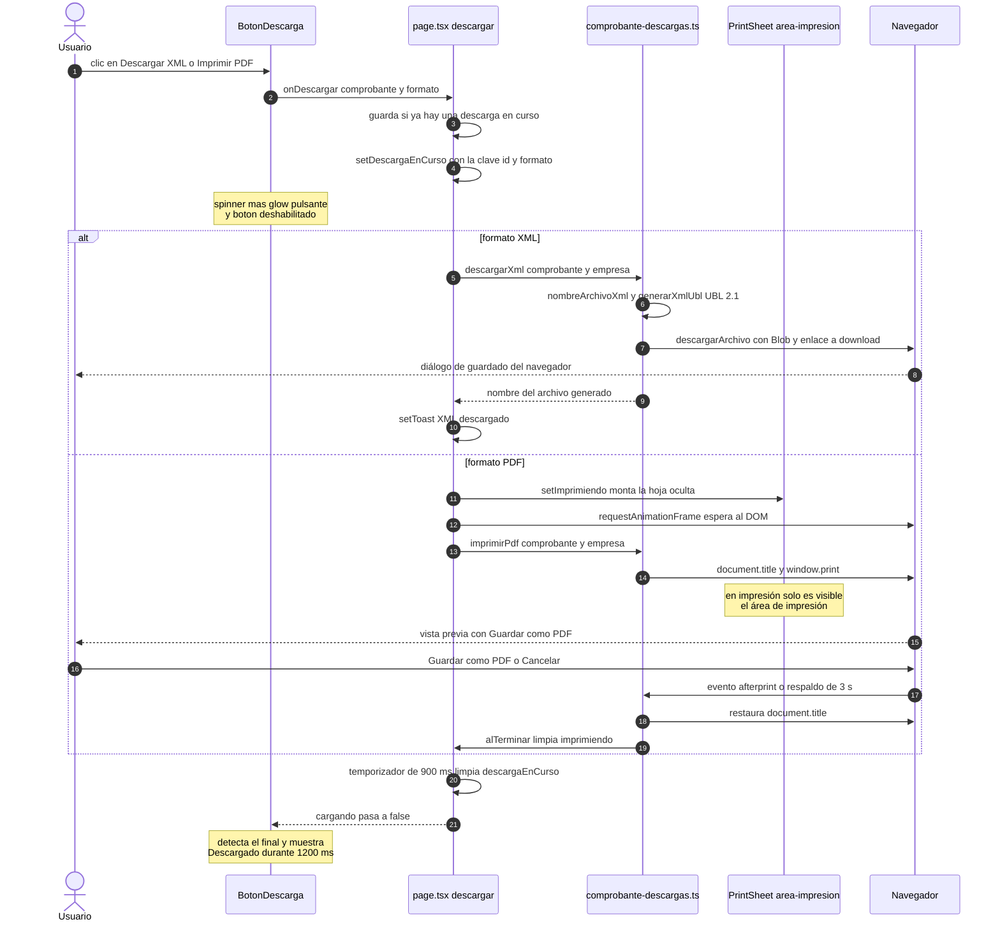
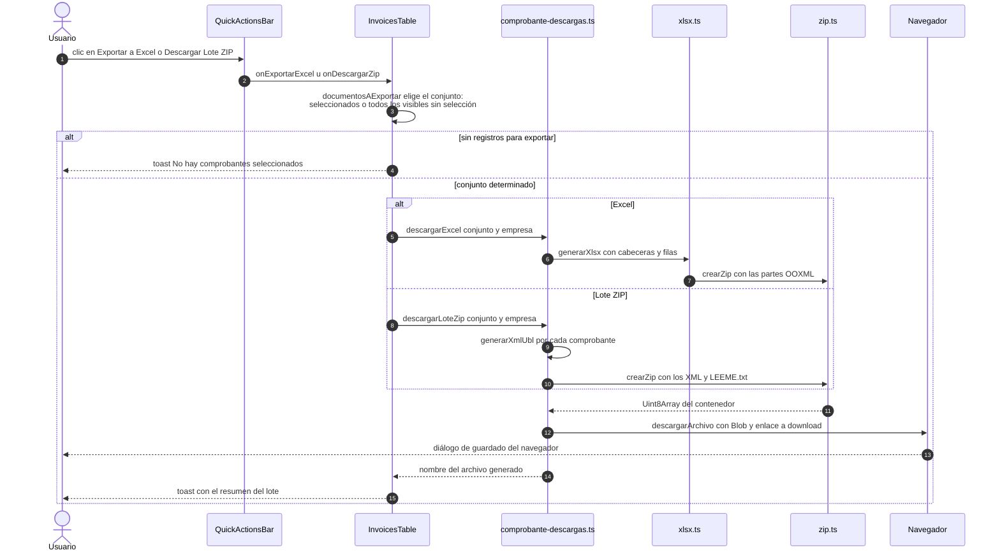
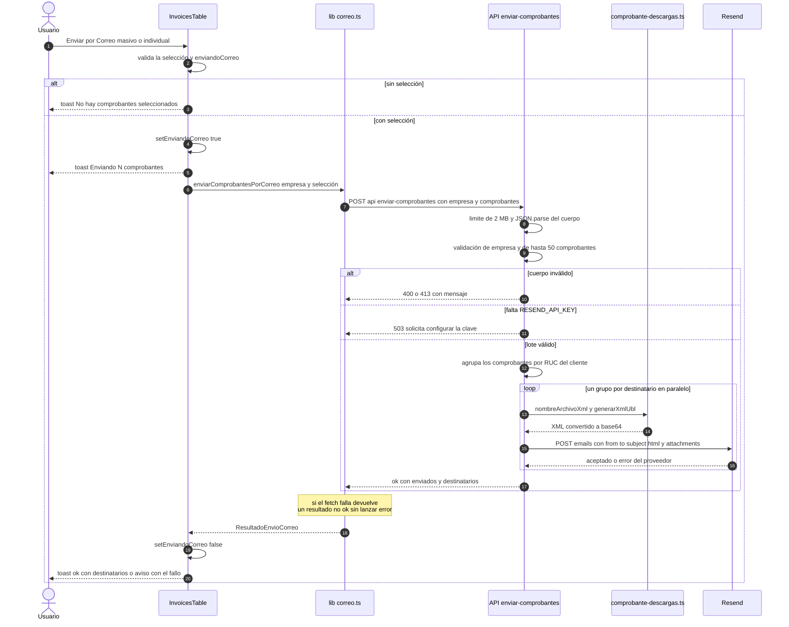

# Portal de Facturación Electrónica — Grupo TDM

Documento técnico: **para qué sirve**, **cómo funciona** y **cómo está construido**.

---

## 1. Qué es y para qué sirve

Es un **prototipo de portal web** (una sola página) para que el área de facturación del
**Grupo TDM** consulte, filtre, previsualice y exporte los **comprobantes electrónicos**
de sus tres empresas:

| id interno | Nombre corto | Razón social | RUC |
| --- | --- | --- | --- |
| `servicios` | TDM Servicios | TDM SERVICIOS S.A.C. | 20615209385 |
| `geosinteticos` | TDM Geosintéticos | TDM GEOSINTETICOS S.A. | 20551198058 |
| `asfaltos` | TDM Asfaltos | TDM ASFALTOS S.A.C. | 20514831620 |

### Qué resuelve

1. **Cambiar de empresa emisora** sin recargar la página (pestañas de cristal).
2. **Saber de un vistazo** cómo va el periodo: total facturado del mes, aprobados,
   pendientes y anulados (tarjetas KPI).
3. **Encontrar un comprobante** por N° de documento, cliente o RUC, y por tipo de
   documento, estado SUNAT, N° SAP y rango de fechas.
4. **Ver la representación impresa** de cualquier comprobante antes de entregarlo.
5. **Exportar trabajo real**:
   - **PDF** del comprobante (vía diálogo de impresión del navegador → "Guardar como PDF").
   - **XML** UBL 2.1 del comprobante.
   - **Excel (.xlsx)** con los comprobantes seleccionados, o con todos los visibles si
     no hay ninguno marcado.
   - **ZIP** con el XML de cada comprobante seleccionado (o de todos los visibles, con
     la misma regla) + un manifiesto `LEEME.txt`.
6. **Enviar por correo real** los comprobantes (XML adjunto) a cada cliente, agrupando
   por destinatario, a través de Resend desde el servidor.

### Qué es real y qué es simulado (importante)

| Pieza | Estado |
| --- | --- |
| Datos de comprobantes y empresas | **Simulados** (`lib/mock-data.ts`) |
| "Consulta a SUNAT" al cambiar de empresa | **Simulada**: un `setTimeout` de 700 ms |
| Estado SUNAT y número SAP | **Simulado** en los datos |
| Descarga de XML | **Real** (se genera el UBL 2.1 en el navegador) |
| Descarga de Excel y ZIP | **Real** (se generan los binarios en el navegador) |
| Exportación a PDF | **Real** (usa la impresión nativa del navegador) |
| Envío por correo | **Real** (Resend), pero los buzones de los clientes no existen: se derivan del RUC |
| Firma digital del XML | **No** (bloque `ext:UBLExtensions` vacío, marcado como simulado) |

> El objetivo es demostrar flujo, UX y capacidad de exportación. **No realiza operaciones
> reales ante SUNAT.**

---

## 2. Cómo funciona

### 2.1 Flujo de usuario

```
Seleccionar empresa (píldoras)
        │
        ├─► estado de carga simulado (700 ms) con skeletons
        │
        ▼
Ficha fiscal SUNAT + KPIs del mes + Filtros + Tabla de comprobantes
        │
        ├─► Filtrar/buscar ....... recalcula la tabla (en memoria, sin red)
        ├─► Marcar comprobantes .. selección masiva (se limpia lo que deja de ser visible)
        ├─► Ver detalle .......... modal con la representación impresa
        ├─► PDF                    documento oculto → window.print()
        ├─► XML / Excel / ZIP .... Blob + <a download> en el navegador
        └─► Correo ............... POST /api/enviar-comprobantes → Resend
```

### 2.2 Flujo de datos (no hay base de datos ni backend de negocio)

Todo el estado vive en **memoria del navegador**:

```
lib/mock-data.ts  ──►  EMPRESAS: Empresa[]  (cada Empresa trae sus Comprobante[])
                              │
   app/page.tsx  ──── useMemo ├─► empresa (la seleccionada)
                              ├─► comprobantesFiltrados = aplicarFiltros(empresa.comprobantes, filtros)
                              └─► metricas = calcularMetricas(empresa.comprobantes)
                              │
                              ▼
   props  ──►  components/*  (filtros, tarjetas, tabla, modal…)
```

No hay peticiones de red para listar ni filtrar: **filtrar es un `useMemo` sobre un array**.
La única llamada al servidor es la del correo.

---

## 3. Arquitectura

### 3.1 Stack

| Capa | Tecnología |
| --- | --- |
| Framework | **Next.js 16.3.6** (App Router, Turbopack) |
| UI | **React 19.2.8** (Client Components) |
| Estilos | **Tailwind CSS v4** (`@import "tailwindcss"` + `@custom-variant dark`) |
| Animación | **GSAP 3.15.0** + **@gsap/react 2.1.2** (`useGSAP`) |
| Iconos | **lucide-react** |
| Tipografías | Geist / Geist Mono (`next/font`) |
| Correo | **Resend** (API REST, sin SDK) |
| Gestor de paquetes | **pnpm** (`pnpm-lock.yaml`, `packageManager: pnpm@11.5.0`) |

### 3.2 Capas del proyecto

```
┌──────────────────────────────────────────────────────────────────┐
│ PRESENTACIÓN (Client Components)                                 │
│  app/page.tsx ............. orquestador: estado, filtros, acciones│
│  components/* ............. UI pura + animaciones GSAP            │
│  app/globals.css .......... sistema de diseño (glass, auras, kf)  │
└───────────────┬──────────────────────────────────────────────────┘
                │ props / callbacks
┌───────────────▼──────────────────────────────────────────────────┐
│ DOMINIO Y CÁLCULO (sin React, testeable en aislamiento)           │
│  lib/types.ts ............. modelo (Comprobante, Empresa, …)      │
│  lib/mock-data.ts ......... dataset simulado (fuente de verdad)   │
│  lib/format.ts ............ moneda, fechas, estilos de badges     │
│  lib/utils.ts ............. cn(), claveDescarga()                 │
└───────────────┬──────────────────────────────────────────────────┘
                │
┌───────────────▼──────────────────────────────────────────────────┐
│ GENERACIÓN DE ARCHIVOS (100 % en el navegador, sin dependencias)  │
│  lib/comprobante-descargas.ts ... XML UBL 2.1, nombres, blobs     │
│  lib/xml.ts .................... escape XML                       │
│  lib/xlsx.ts ................... OOXML SpreadsheetML mínimo       │
│  lib/zip.ts .................... escritor ZIP propio (store + CRC)│
└──────────────────────────────────────────────────────────────────┘
                │
┌───────────────▼──────────────────────────────────────────────────┐
│ SERVIDOR (Route Handler)                                          │
│  app/api/enviar-comprobantes/route.ts ... Resend + validación     │
└──────────────────────────────────────────────────────────────────┘
```

### 3.3 Mapa de archivos

| Ruta | Responsabilidad |
| --- | --- |
| `app/layout.tsx` | `<html>`, tipografías, metadata y **script anti-flash de tema** (dark-first, preferencia en `localStorage["tdm-tema"]`). |
| `app/page.tsx` | Única página. Estado del portal, filtrado, métricas, exportaciones, toasts y animaciones GSAP de página/cambio de empresa. |
| `app/api/enviar-comprobantes/route.ts` | `POST` que valida el lote, agrupa por cliente, genera los XML y llama a Resend. La API key nunca llega al navegador. |
| `app/globals.css` | Sistema de diseño: `.vidrio`, `.vidrio-tenue`, `.borde-brillo`, `.aura-*`, `.texto-degradado`, keyframes y reglas de impresión. |
| `components/portal-header.tsx` | Cabecera sticky glass: marca, toggle de tema, perfil y barra de progreso. |
| `components/company-selector.tsx` | Pestañas de empresa como píldoras de cristal con **indicador deslizante GSAP**. |
| `components/company-info-card.tsx` | Ficha informativa SUNAT de la empresa (estado, condición, domicilio, actividad…). |
| `components/kpi-cards.tsx` | Cuatro tarjetas KPI con aura, acento y glow. |
| `components/filters-panel.tsx` | Búsqueda + 2 selectores + N° SAP + rango de fechas y atajos. Exporta `FILTROS_INICIALES`. |
| `components/invoices-table.tsx` | Tabla de escritorio + tarjetas móviles, selección masiva, acciones por fila y acciones rápidas. |
| `components/quick-actions-bar.tsx` | Barra de selección global y acciones masivas; exporta `CasillaSeleccion`. |
| `components/status-badge.tsx` | Insignia de estado SUNAT (con tono `auto` o `claro` para el papel). |
| `components/invoice-paper.tsx` | Representación impresa del comprobante (siempre en blanco). Se reutiliza en modal y en impresión. |
| `components/print-sheet.tsx` | Contenedor `.area-impresion`: solo se imprime al exportar a PDF. |
| `components/invoice-detail-modal.tsx` | Modal de vista previa: apertura animada y **micro-tilt 3D** de la hoja. |
| `components/boton-descarga.tsx` | Botón de descarga con press, glow pulsante, `spinner → check` y etiqueta "Generando… / ¡Descargado!". |
| `components/toast.tsx` | Notificaciones con autocierre y barra de cuenta atrás. |
| `components/skeletons.tsx` | Placeholders de carga (KPIs, filas, tarjetas) con barrido de brillo. |
| `components/theme-toggle.tsx` | Alterna la clase `.dark` y persiste la preferencia. |
| `lib/*` | Dominio, formateo y generadores de archivos (ver §3.2). |

### 3.4 Modelo de dominio (`lib/types.ts`)

```
Empresa  ─┬─ id, nombreCorto, razonSocial, ruc
          ├─ estado: "ACTIVO" | "BAJA DE OFICIO"
          ├─ condicion: "HABIDO" | "NO HABIDO"
          ├─ domicilioFiscal, actividadPrincipal
          ├─ comprobantesElectronicos: TipoDocumento[]
          └─ comprobantes: Comprobante[]
                      │
Comprobante  ─┬─ numero, tipo, cliente {ruc, razonSocial}
              ├─ fechaEmision, fechaVencimiento   (ISO yyyy-mm-dd)
              ├─ descripcion, items: ItemComprobante[]
              ├─ baseImponible, igv, total
              ├─ estadoSunat: "Aprobado" | "Pendiente" | "Anulado"
              ├─ numeroSap: string
              └─ formaPago, observacion?
```

`lib/mock-data.ts` no escribe esos números a mano: tiene un constructor `documento()`
que **deriva** `baseImponible` (suma de ítems), `igv` (18 %, o 0 en guías y retenciones)
y `total`, de modo que el dataset nunca es inconsistente.

### 3.5 Estado en `app/page.tsx`

| Estado | Para qué |
| --- | --- |
| `empresaId` | Empresa seleccionada. |
| `filtros` | Búsqueda, tipo, estados y rango de fechas (`FiltrosState`). |
| `detalle` | Comprobante abierto en el modal (`null` = cerrado). |
| `toast` | Notificación activa; se autocierra a los 3400 ms. |
| `imprimiendo` | Comprobante montado en `PrintSheet` para exportar a PDF. |
| `cargando` | Simula la consulta a SUNAT (700 ms) y activa skeletons. |
| `descargaEnCurso` | Clave `id:FORMATO` del archivo que se está entregando. |
| `solicitudCarga` | Contador que reinicia el temporizador de carga al cambiar de empresa. |

Reutiliza `useMemo` para la empresa, los comprobantes filtrados y las métricas;
`useRef` para temporizadores y para los contenedores que anima GSAP.

---

## 4. Pipeline de exportación

### 4.1 PDF

No se usa ninguna librería de PDF. El flujo es:

1. `setImprimiendo(comprobante)` monta `PrintSheet` (contenedor `.area-impresion`).
2. Un `requestAnimationFrame` garantiza que el DOM ya está pintado.
3. `imprimirPdf()` cambia `document.title` al nombre sugerido
   (`Factura-F001-0004521-20615209385.pdf`), llama a `window.print()` y restaura el
   título al recibir `afterprint` (con un respaldo por si el navegador no lo emite).
4. `@media print` en `globals.css` oculta **todo** salvo `.area-impresion`: el resto
   del portal se saca del flujo con `display: none`
   (`#portal-raiz > *:not(.area-impresion)`), porque ocultarlo solo con
   `visibility: hidden` conservaba su altura y generaba páginas en blanco después de
   la primera. El PDF queda con únicamente el comprobante, a A4 y con márgenes de 12 mm.

### 4.2 XML (UBL 2.1)

`generarXmlUbl()` construye el documento como un array de líneas y lo une. Detalles:

- Raíz correcta por tipo: `Invoice`, `CreditNote` o `DebitNote` (y con ella cambian
  `InvoiceLine`/`CreditNoteLine`/`DebitNoteLine` y `InvoicedQuantity`/…).
- Catálogos SUNAT resumidos: tipo de documento (`01`, `03`, `07`, `08`, `09`, `20`),
  unidad de medida (`NIU`, `ZZ`, `DAY`, `TNE`), tipo de documento de identidad
  (`1` DNI / `6` RUC) según el largo del documento del cliente.
- Bloque de emisor con distrito/provincia derivados del domicilio fiscal.
- `cac:BillingReference` para notas cuando la observación contiene el comprobante
  referenciado.
- El XML **no está firmado** (se indica explícitamente en el propio archivo).

### 4.3 Excel y ZIP

Ambos se generan con un **ZIP propio** (`lib/zip.ts`): método `store` (sin compresión),
cabeceras + CRC32 calculado con tabla. Eso permite:

- **`.xlsx`**: `lib/xlsx.ts` escribe las seis partes mínimas de OOXML (content types,
  relaciones, libro, hoja, estilos) usando `inlineStr`, así que no hace falta la tabla
  de cadenas compartidas. Cabeceras en negrita y anchos de columna calculados.
- **`.zip`**: un XML por comprobante + `LEEME.txt` con el inventario del lote.

La entrega siempre es la misma: `descargarArchivo()` crea un `Blob`, un `<a download>`
invisible, dispara el clic y revoca la URL después.

### 4.4 Correo (Resend, servidor)

`POST /api/enviar-comprobantes`:

1. Limita el cuerpo (2 MB) y el lote (50 comprobantes) y valida lo mínimo necesario.
2. Exige `RESEND_API_KEY`; si falta, responde `503` con un mensaje claro (nunca falla en
   silencio).
3. **Agrupa por cliente**: un correo por destinatario, con el XML de cada comprobante
   adjunto en base64 y una plantilla HTML con la tabla de comprobantes.
4. Usa `Promise.allSettled` para que un fallo puntual no aborte el resto y devuelve
   cuántos se enviaron y a quién.

Variables de entorno (`.env.example`): `RESEND_API_KEY`, `CORREO_EMISOR`,
`CORREO_DESTINO_PRUEBA` (en pruebas redirige **todos** los correos a un solo buzón,
porque los RUC simulados no tienen buzón real).

### 4.5 Diagramas de secuencia

> Los diagramas siguientes están escritos en **Mermaid** y se renderizan automáticamente
> en la vista previa de GitHub. Reflejan el código actual: `app/page.tsx` (orquestador),
> `components/boton-descarga.tsx` + `components/invoices-table.tsx` (disparadores),
> `lib/*` (generadores), `app/api/enviar-comprobantes/route.ts` (servidor) y Resend.

#### 4.5.1 Descarga de un comprobante (XML y PDF)



#### 4.5.2 Exportación masiva (Excel y lote ZIP)



#### 4.5.3 Envío por correo



Detalles que conviene tener presentes al leer los diagramas:

- El estado `descargaEnCurso` es **global** (lo comparte la tabla y el modal), así que solo
  puede haber una descarga por fila en curso a la vez; el guard inicial la protege.
- Excel y ZIP **no** pasan por `descargaEnCurso`: se generan y se entregan en el mismo
  clic, y su retroalimentación es el toast.
- El PDF no produce un archivo binario: se apoya en el diálogo de impresión, por eso
  restaura `document.title` y espera a `afterprint`.
- En el correo, un fallo de un cliente no aborta el resto (`Promise.allSettled`): la ruta
  responde `502` solo si **ningún** correo salió.
- `CORREO_DESTINO_PRUEBA` intercepta todos los destinatarios, lo que hace el diagrama
  fácil de probar con un solo buzón.

---

## 5. Capa visual y de animación

### 5.1 Sistema de diseño (`app/globals.css`)

- **Dark-first**: `app/layout.tsx` aplica `.dark` antes del primer pintado si no hay
  preferencia guardada; el botón de tema sigue funcionando en ambos sentidos.
- Clases reutilizables en `@layer components`:
  - `.vidrio` / `.vidrio-tenue`: superficies glassmorphism (blur + borde `white/10` + sombra profunda en oscuro).
  - `.borde-brillo`: hairline con gradiente de acento (truco de `mask-composite`).
  - `.aura-corporativa`, `.aura-azul|esmeralda|ambar|rosa`: halos radiales.
  - `.texto-degradado`: texto con degradado de marca.
- Tokens de color: índigo/azul eléctrico como acento, esmeralda = aprobado,
  ámbar = pendiente, carmesí = anulado.
- Keyframes: `flotarOrbe`, `brilloBarrido`, `barraToast`, `pulsoLuminoso`, `fadeInUp`,
  `barraIndeterminada`.

### 5.2 Animación con GSAP

Todas las animaciones usan `useGSAP` de `@gsap/react`, con `scope` (los selectores de
texto se resuelven dentro del contenedor) y limpieza automática del contexto. Cuando hay
dependencias se usa `revertOnUpdate`, y el respeto a `prefers-reduced-motion` se resuelve
con `gsap.matchMedia()` o comprobaciones explícitas.

| Efecto | Dónde | Implementación |
| --- | --- | --- |
| Entrada escalonada de la página | `app/page.tsx` | `gsap.from("[data-anim='reveal']", { y, opacity, stagger })` |
| Transición al cambiar de empresa | `app/page.tsx` | `fromTo` fade & slide sobre el bloque de contenido |
| Indicador deslizante de las pestañas | `company-selector.tsx` | `gsap.to({ x, width })` + `ResizeObserver` |
| Entrada de filas y tarjetas | `invoices-table.tsx` | `gsap.from` con `stagger` |
| Hover de fila | `invoices-table.tsx` | delegación en el `<tbody>` + `gsap.to({ y })` |
| Press de botones de acción | `invoices-table.tsx` | delegación `pointerdown` + `fromTo({ scale: 0.95 → 1 }, back.out)` |
| Apertura del modal | `invoice-detail-modal.tsx` | telón en fundido + panel `scale 0.9 → 1` con `back.out` |
| Micro-tilt 3D de la hoja | `invoice-detail-modal.tsx` | `gsap.quickTo` sobre `rotationX`/`rotationY` siguiendo el cursor |
| Feedback de descarga | `boton-descarga.tsx` | glow (`pulsoLuminoso`), `spinner → check` y etiqueta animada |

---

## 6. Accesibilidad y rendimiento (lo que ya está resuelto)

- **ARIA**: `role="tablist"/"tab"` con `aria-selected` en las empresas; `role="dialog"` +
  `aria-modal` en el modal; `role="status"` + `aria-live="polite"` en toasts y contador de
  selección; `aria-label`/`title` en todos los botones de acción; `sr-only` en cabeceras.
- **Teclado**: el modal se cierra con `Escape` y bloquea el scroll de fondo.
- **Movimiento reducido**: ninguna animación se ejecuta si el sistema pide reducirlo.
- **Sin dependencias para binarios**: el ZIP y el XLSX son escritores propios, lo que
  reduce la superficie de la cadena de suministro (ver `pnpm-workspace.yaml` /
  `allowBuilds` y `pnpm approve-builds`).
- **Renderizado**: las animaciones de entrada usan `clearProps` para no dejar estilos
  inline que interfieran con hover, `sticky` o el propio GSAP.

---

## 7. Cómo ejecutarlo

```bash
# 1. Dependencias (el proyecto usa pnpm, no npm)
pnpm install

# 2. Opcional: envío real de correo
cp .env.example .env.local     # y completa RESEND_API_KEY

# 3. Desarrollo
pnpm dev                        # http://localhost:3000

# 4. Calidad
pnpm lint
pnpm build
```

### Limitaciones conocidas

- No hay autenticación: la ruta de correo es pública (mitigada con límites de tamaño y lote).
- No hay persistencia: al recargar se vuelve al dataset simulado.
- El PDF depende del diálogo de impresión del navegador (no se genera un PDF binario).
- El XML no está firmado digitalmente y los datos no son válidos ante SUNAT.
