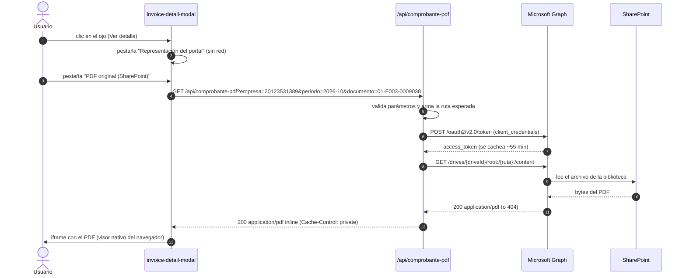

# Ver los PDF de SharePoint en la vista previa del portal

Guía técnica: **cómo conectar el ojo de "vista previa" del portal con los PDF reales que
viven en SharePoint**, qué opciones existen y cuál conviene. Documento de diseño: describe el
trabajo a hacer, no una integración ya implementada.

---

## 1. Punto de partida (lo que hace hoy el ojo)

El ícono de ojo (y el botón **Ver detalle** de cada fila) abre
`components/invoice-detail-modal.tsx`, que muestra `components/invoice-paper.tsx`: una
**representación impresa simulada** que se arma en el navegador con los datos del comprobante
(la misma que se usa para el PDF nativo vía `window.print()`).

Es decir: hoy el "PDF" no existe como archivo. La meta es que el ojo muestre **el PDF que el
área de facturación ya archiva en SharePoint**, que es el documento real emitido.

```
HOY                                    META
ojo → modal → InvoicePaper (HTML)      ojo → modal → [Representación | PDF de SharePoint]
                                                    │
                                                    └─ iframe → /api/comprobante-pdf → Graph → SharePoint
```

---

## 2. Las cuatro formas de hacerlo

| Opción | Cómo funciona | Requisitos | Riesgo |
| --- | --- | --- | --- |
| **A. Proxy con Microsoft Graph** (recomendada) | El navegador pide a una ruta propia `/api/comprobante-pdf?…`; el servidor pide el archivo a Graph con **credenciales de aplicación** y lo devuelve como `application/pdf` | App registrada en Entra ID + permiso de lectura sobre el sitio + 5 variables de entorno | Bajo: el token nunca llega al navegador y funciona con bibliotecas privadas |
| **B. Enlaces compartidos por archivo** | Cada comprobante guarda una URL "Cualquiera con el vínculo" que se embebe en un `iframe` | Compartir archivo por archivo; el tenant debe permitir enlaces anónimos | Alto: expone URLs fuera del portal, hay que rotarlas y depende de la configuración del tenant |
| **C. Web part / embed de SharePoint** | `iframe` a `https://{tenant}.sharepoint.com/sites/{sitio}/_layouts/15/embed.aspx?…` | Sesión de SharePoint en el navegador del usuario | Medio: funciona solo para usuarios ya autenticados en SharePoint; dentro de un portal propio suele dar error de cookie de terceros |
| **D. Sincronizar la biblioteca** | Bajar los PDF con OneDrive / un job y servirlos del propio servidor | Almacenamiento propio, proceso de sincronización | Medio: duplica los documentos y hay que mantener la copia al día (útil si además quieres inyectarlos al lote ZIP) |

**Recomendación: la opción A.** Es la única que mantiene el token fuera del navegador, funciona
con bibliotecas privadas, permite cachear y auditar, y encaja con el patrón que el proyecto ya
usa para Resend (`POST /api/enviar-comprobantes`: el secreto vive solo en el servidor y, si
falta, la app avisa en lugar de fallar en silencio).

---

## 3. Cómo funciona la opción A



Claves del diseño:

- **Una sola ruta propia** (`/api/comprobante-pdf`) concentra la autenticación, la validación de
  rutas, el caché y el manejo de errores. El navegador nunca ve el token.
- **Cachear el token** en el módulo del servidor (`expires_in` menos un margen) evita pedir uno
  por cada PDF.
- **Reconstruir la ruta** en el servidor a partir de `empresa + periodo + número`, en lugar de
  confiar en una ruta que venga del cliente (evita *path traversal* y rutas arbitrarias).

---

## 4. Convención de nombres y mapeo comprobante → archivo

La convención **SUNAT** ya está escrita en `lib/comprobante-descargas.ts`
(`nombreArchivoXml` = `{RUC}-{tipo}-{serie}-{número}.xml`, con `codigoTipoDocumento()` para el
código `01/03/07/08/09/20`). Conviene usarla también para el PDF:

```
{rutaBase}/{periodo}/{RUC}-{codigoTipo}-{numero}.pdf
Ej.: /Comprobantes/2026-10/20123531389-01-F003-0009038.pdf
```

Ventajas: coincide con el nombre estándar que SUNAT y los OSE entregan, ordena por mes sin
depender de subcarpetas por empresa y evita colisiones entre las tres empresas del grupo (el RUC
del emisor va en el nombre).

Puntos importantes del mapeo:

1. **Quién sube los PDF**: el proceso que archiva hoy los comprobantes en SharePoint (a mano o
   con un flujo de Power Automate) debe respetar esa ruta. Si hoy están en carpetas por mes con
   otro nombre, hay dos salidas: normalizar los nombres en SharePoint, o hacer la búsqueda por
   contenido (`/drives/{driveId}/root/search(q='F003-0009038')`) — más lento y menos determinista.
2. **Excepciones**: para comprobantes viejos o fuera de la convención, agregar al modelo un campo
   opcional `archivoSharePoint?: string` con la ruta relativa exacta. El servidor la usa solo si
   empieza con la `rutaBase` permitida.
3. **Faltantes**: si Graph responde `404`, la ruta propia devuelve `404` con
   `{"error": "El PDF aún no está publicado"}` y **la ruta esperada** en el cuerpo: es el dato que
   necesita el área de facturación para subir el archivo que falta.

---

## 5. Configuración paso a paso (una sola vez)

### 5.1 Registrar la aplicación en Entra ID

1. Portal de Azure → **Entra ID** → *Registros de aplicaciones* → **Nueva aplicación**.
2. Nombre: `Portal Facturación Electrónica`. Tipo: **solo aplicación** (sin URI de redirección;
   no hay usuario interactivo).
3. Copiar **Id. de aplicación (cliente)** e **Id. de directorio (inquilino)**.
4. *Certificados y secretos* → **Nuevo secreto de cliente**. Copiar el **valor** (no el id): es
   el que se guarda en `MS_CLIENT_SECRET`. Anotar la caducidad (máximo 24 meses) y agendarla.
   > Mejor aún: usar **certificado** en lugar de secreto. El secreto es más simple de arrancar,
   > pero caduca y hay que rotarlo.

### 5.2 Dar permiso sobre la biblioteca

Dos caminos:

- **`Sites.Selected` (mínimo privilegio, recomendado)**: se concede a la app permiso **solo** en
  el sitio de comprobantes. Después de asignar el permiso en Entra ID y otorgar el
  consentimiento del administrador, un administrador (Graph Explorer o PnP PowerShell, que sí
  puede conceder) autoriza la app en el sitio:

  ```
  POST https://graph.microsoft.com/v1.0/sites/{siteId}/permissions
  {
    "roles": ["read"],
    "grantedToIdentities": [
      { "application": { "id": "{clientId}", "displayName": "Portal Facturación Electrónica" } }
    ]
  }
  ```

  Con PnP PowerShell: `Grant-PnPAzureADAppSitePermission -AppId {clientId} -DisplayName "Portal
  Facturación" -Site https://{tenant}.sharepoint.com/sites/{sitio} -Permissions Read`.

- **`Sites.Read.All` (simple, más amplio)**: lectura de **todos** los sitios del tenant. Solo si
  el área de TI prefiere no administrar permisos por sitio.

Nunca `Sites.FullControl.All` para la app del portal: lectura es suficiente.

### 5.3 Averiguar los identificadores del sitio y de la biblioteca

```
# Sitio por ruta
GET https://graph.microsoft.com/v1.0/sites/{tenant}.sharepoint.com:/sites/{sitio}
    -> id: "{host},{siteCollectionId},{siteId}"

# Biblioteca por defecto (Documentos) y todas las bibliotecas
GET https://graph.microsoft.com/v1.0/sites/{siteId}/drive
GET https://graph.microsoft.com/v1.0/sites/{siteId}/drives
    -> id = MS_DRIVE_ID
```

### 5.4 Variables de entorno (`.env.local`, solo servidor)

| Variable | Para qué |
| --- | --- |
| `MS_TENANT_ID` | Id. de directorio (inquilino) |
| `MS_CLIENT_ID` | Id. de aplicación |
| `MS_CLIENT_SECRET` | Secreto (o el certificado, ver más abajo) |
| `MS_DRIVE_ID` | Biblioteca de documentos de comprobantes |
| `MS_RUTA_BASE` | Prefijo dentro de la biblioteca, p. ej. `/Comprobantes` |

Reglas: **nunca** con prefijo `NEXT_PUBLIC_` (eso publicaría el secreto en el bundle del
navegador); en producción van en el gestor de secretos del hosting, igual que `RESEND_API_KEY`.

### 5.5 Cómo se obtiene el token

```
POST https://login.microsoftonline.com/{MS_TENANT_ID}/oauth2/v2.0/token
Content-Type: application/x-www-form-urlencoded

client_id={MS_CLIENT_ID}
&client_secret={MS_CLIENT_SECRET}
&scope=https://graph.microsoft.com/.default
&grant_type=client_credentials
```

### 5.6 Cómo se pide el archivo

```
# Por ruta (determinista, recomendado)
GET https://graph.microsoft.com/v1.0/drives/{MS_DRIVE_ID}/root:/{ruta}:/content
Authorization: Bearer {access_token}

# Alternativa: primero metadatos (id, tamaño, eTag) y luego el contenido
GET /drives/{driveId}/root:/{ruta}?$select=id,size,lastModifiedDateTime,eTag
GET /drives/{driveId}/items/{itemId}/content
```

---

## 6. Si se prefiere no hacer proxy de bytes

`GET /drives/{driveId}/root:/{ruta}` con `$select=@microsoft.graph.downloadUrl` devuelve una URL
**preautenticada y temporal** (≈1 hora). La ruta propia podría responder ese JSON y el `iframe`
consumiría la URL directamente: el servidor no gasta ancho de banda.

- **A favor:** menos carga en el servidor del portal.
- **En contra:** la URL queda en el navegador y en el historial (tiene acceso al PDF mientras no
  expire), el `iframe` depende de que el navegador acepte el dominio de SharePoint como origen
  del PDF y hay que manejar la expiración en la UI.

Para un portal interno con pocos usuarios, el proxy de bytes es más simple y más seguro.

---

## 7. Cambios concretos en el código cuando se implemente

| Archivo | Cambio |
| --- | --- |
| `lib/sharepoint.ts` *(nuevo)* | `obtenerToken()` con caché en módulo, `rutaPdf(empresa, comprobante)` (convención SUNAT) y `descargarPdf(ruta): Promise<Response>` |
| `app/api/comprobante-pdf/route.ts` *(nuevo)* | `GET` que valida los parámetros (RUC, periodo `yyyy-mm`, número `SERIE-NUMERO`), reconstruye la ruta, verifica que empiece con `MS_RUTA_BASE`, pide el PDF y responde `application/pdf` con `Content-Disposition: inline` y `Cache-Control: private, max-age=300`. Sin variables → `503` con instrucciones; sin archivo → `404` con la ruta esperada |
| `lib/types.ts` | `archivoSharePoint?: string` en `Comprobante` (excepciones) |
| `lib/mock-data.ts` | Nada obligatorio: la ruta se deriva. Opcional: rutas de ejemplo para el demo |
| `lib/comprobante-descargas.ts` | Reutilizar `codigoTipoDocumento()` para armar el nombre del PDF de SharePoint (hoy solo se usa en el XML) |
| `components/invoice-detail-modal.tsx` | Selector de dos pestañas: *Representación del portal* / *PDF original (SharePoint)*; en la segunda, `iframe` (o `<object type="application/pdf">`) con `src` a la ruta propia, más estados de carga, `404` ("aún no publicado") y `503` ("falta configurar") |
| `components/invoices-table.tsx` | Opcional: el botón de descarga podría ofrecer "PDF del portal" vs "PDF de SharePoint" |
| `.env.local` | Las cinco variables de `MS_*` |
| `README.md` / `ARQUITECTURA.md` | Documentar la integración y sus variables |

Detalle de la UI recomendada: el `iframe` debe apuntar a **la ruta propia**
(`/api/comprobante-pdf?...`), no a `sharepoint.com`; el visor de PDF del navegador se encarga del
resto y así no hay problemas de cookies de terceros.

---

## 8. Seguridad, caché y operación

- **Autorización del usuario**: hoy el portal no tiene autenticación. Mientras siga así, la ruta
  queda pública (como la de correo): hay que limitar por tamaño, por lote y considerar firmar la
  URL o poner el portal detrás de Entra ID antes de exponer PDF fiscales.
- **Validación de entrada**: RUC de 11 dígitos, periodo `^\d{4}-\d{2}$`, número `^[A-Z]{1,2}\d{2}-\d{7}$`
  y verificación de que la ruta final empiece con `MS_RUTA_BASE`. Nada de rutas que venga del
  cliente tal cual.
- **Caché**: `Cache-Control: private, max-age=300` o `s-maxage` si hay CDN. Los PDF archivados no
  cambian; si se reemplazan, usar el `eTag` como versión en la URL (`&v={eTag}`).
- **Tokens**: cachear con margen (p. ej. 55 min de 60), y manejar `401` renovando una vez.
- **Errores de Graph**: `429` trae `Retry-After` (respetarlo), `404` = archivo faltante,
  `403` = permiso de sitio no concedido, `503` = variables sin configurar.
- **Tamaño y tiempo**: los PDF de comprobantes pesan pocos KB; conviene un límite de tiempo
  (5 s) y de tamaño (p. ej. 10 MB) antes de reenviar el `stream` al navegador.
- **Auditoría**: registrar en el log del servidor `{usuario, empresa, comprobante, resultado}` cada
  consulta de PDF: es el dato que suele pedir auditoría interna.
- **Depuración**: no loggear el token ni el secreto; para probar sin portal usad Graph Explorer o
  `curl` con el token de la app.

---

## 9. Prueba de aceptación

```bash
# 1) Token
curl -s -X POST "https://login.microsoftonline.com/$MS_TENANT_ID/oauth2/v2.0/token" \
  -d "client_id=$MS_CLIENT_ID" -d "client_secret=$MS_CLIENT_SECRET" \
  -d "scope=https://graph.microsoft.com/.default" -d "grant_type=client_credentials"

# 2) ¿Existe el archivo? (metadatos: nombre, tamaño, fecha)
curl -s -H "Authorization: Bearer $TOKEN" \
  "https://graph.microsoft.com/v1.0/drives/$MS_DRIVE_ID/root:/Comprobantes/2026-10/20123531389-01-F003-0009038.pdf"

# 3) Descarga
curl -s -H "Authorization: Bearer $TOKEN" -o prueba.pdf \
  "https://graph.microsoft.com/v1.0/drives/$MS_DRIVE_ID/root:/Comprobantes/2026-10/20123531389-01-F003-0009038.pdf:/content"

# 4) Ruta del portal (cuando esté implementada)
curl -s -o portal.pdf -w "%{http_code} %{content_type}\n" \
  "http://localhost:3000/api/comprobante-pdf?empresa=20123531389&periodo=2026-10&numero=01-F003-0009038"
```

Criterios de aceptación:

1. El ojo muestra el PDF real para un comprobante que existe en SharePoint.
2. Si el archivo no está, el modal lo dice con la ruta esperada (sin error técnico).
3. Sin variables de entorno, la app avisa qué falta (nunca falla en silencio).
4. El token y el secreto no aparecen en ningún bundle ni en la respuesta de la API.
5. La segunda apertura del mismo PDF no vuelve a pedir token (caché en memoria).

---

## 10. Decisiones abiertas (a confirmar con TI / facturación)

1. ¿La app tendrá permiso **`Sites.Selected`** (solo el sitio de comprobantes) o se autoriza
   `Sites.Read.All`?
2. ¿Secreto o **certificado** para la credencial?
3. ¿Los PDF ya archivados siguen la convención `{RUC}-{tipo}-{serie}-{número}.pdf`? Si no,
   ¿se normalizan en SharePoint o se agrega el campo `archivoSharePoint` por comprobante?
4. ¿El portal se pondrá detrás de **Entra ID** antes de exponer los PDF? (recomendado)
5. ¿Hace falta también inyectar los PDF al **lote ZIP** descargable, o basta con la vista previa?
