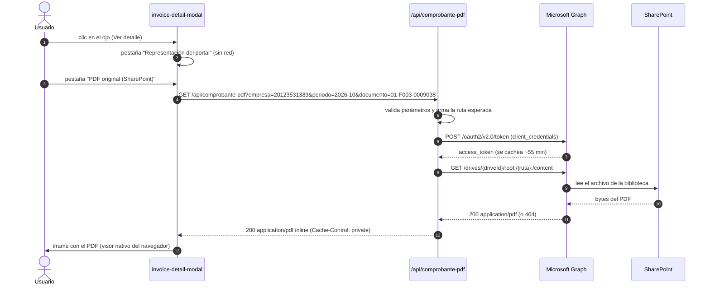

# Ver los PDF de SharePoint en la vista previa del portal

Guía técnica: **cómo conectar el ojo de "vista previa" del portal con los PDF reales que
viven en SharePoint**, qué opciones existen y cuál conviene. Documento de diseño: describe el
trabajo a hacer, no una integración ya implementada.

> **Si no tienes acceso a Entra ID (Azure), ve directo al §2.2**: hay cuatro caminos que no
dependen de Azure ni de permisos de administrador, y el §2.3 explica el único pedido mínimo que
conviene hacerle a TI para habilitar la vía definitiva.

---

## 1. Punto de partida (lo que hace hoy el ojo)

El ícono de ojo (y el botón **Ver detalle** de cada fila) abre
`components/invoice-detail-modal.tsx`, que muestra `components/invoice-paper.tsx`: una
**representación impresa simulada** que se arma en el navegador con los datos del comprobante
(la misma que se usa para el PDF nativo vía `window.print()`).

Es decir: hoy el "PDF" no existe como archivo. La meta es que el ojo muestre **el PDF que el
área de facturación ya archiva en SharePoint**, que es el documento real emitido.

```
HOY                                    META
ojo → modal → InvoicePaper (HTML)      ojo → modal → [Representación | PDF de SharePoint]
                                                    │
                                                    └─ iframe → /api/comprobante-pdf → Graph → SharePoint
```

---

## 2. Las alternativas

### 2.1 Con acceso a Entra ID (Azure)

| Opción | Cómo funciona | Requisitos | Riesgo |
| --- | --- | --- | --- |
| **A. Proxy con Microsoft Graph** (recomendada) | El navegador pide a una ruta propia `/api/comprobante-pdf?…`; el servidor pide el archivo a Graph con **credenciales de aplicación** y lo devuelve como `application/pdf` | App registrada en Entra ID + permiso de lectura sobre el sitio + 5 variables de entorno | Bajo: el token nunca llega al navegador y funciona con bibliotecas privadas |
| **B. Enlaces compartidos por archivo** | Cada comprobante guarda una URL "Cualquiera con el vínculo" que se embebe en un `iframe` | Compartir archivo por archivo; el tenant debe permitir enlaces anónimos | Alto: expone URLs fuera del portal, hay que rotarlas y depende de la configuración del tenant |
| **C. Web part / embed de SharePoint** | `iframe` a `https://{tenant}.sharepoint.com/sites/{sitio}/_layouts/15/embed.aspx?…` | Sesión de SharePoint en el navegador del usuario | Medio: funciona solo para usuarios ya autenticados en SharePoint; dentro de un portal propio suele dar error de cookie de terceros |
| **D. Sincronizar la biblioteca** | Bajar los PDF con OneDrive / un job y servirlos del propio servidor | Almacenamiento propio, proceso de sincronización | Medio: duplica los documentos y hay que mantener la copia al día (útil si además quieres inyectarlos al lote ZIP) |

**Recomendación: la opción A.** Es la única que mantiene el token fuera del navegador, funciona
con bibliotecas privadas, permite cachear y auditar, y encaja con el patrón que el proyecto ya
usa para Resend (`POST /api/enviar-comprobantes`: el secreto vive solo en el servidor y, si
falta, la app avisa en lugar de fallar en silencio).

### 2.2 Sin acceso a Entra ID (ni al consentimiento de administrador)

Las opciones A y B de arriba dependen de permisos de Azure o de TI. Si no los tienes, hay cuatro
caminos que **no tocan Azure** y que igual dejan el PDF a la vista:

| Opción | Cómo funciona | Qué necesitas | Cómo se ve en el portal |
| --- | --- | --- | --- |
| **E. Enlace directo a SharePoint** | El portal guarda (o deriva) la URL del archivo y el ojo la abre en una pestaña nueva | Tu propio permiso de lectura en la biblioteca; si quieres que funcione para todos, un vínculo compartido | Abre el PDF fuera del portal |
| **F. Flujo de Power Automate como mini-API** | Un flujo con disparador **HTTP** busca el archivo, lo lee y responde su contenido en base64; la ruta `/api/comprobante-pdf` consume la URL del flujo | Permiso para crear flujos; verificar que la licencia incluya el disparador HTTP (suele ser Premium) | PDF incrustado en el modal |
| **G. Carpeta sincronizada en el servidor** | El servidor donde corre el portal mantiene la biblioteca sincronizada (OneDrive, `rclone` o unidad de red) y la ruta propia lee el PDF **del disco** | Una cuenta con acceso a la biblioteca en ese servidor y la sincronización activa | PDF incrustado en el modal |
| **H. Copia programada a almacenamiento propio** | Una tarea programada (PowerShell + PnP, `rclone` o un flujo) copia los PDF nuevos a una carpeta o a un blob del proyecto | Cuenta con acceso y una tarea que corra sola | PDF incrustado (y además se puede inyectar al lote ZIP) |

Notas para decidir:

- **G es la mejor relación esfuerzo/resultado si el portal corre en un servidor de la empresa.**
  No hace falta Azure, ni licencias nuevas, ni exponer nada: la ruta `/api/comprobante-pdf` del §3
  se implementa igual y lo único que cambia es el origen (`fs.readFile` del PDF sincronizado en
  lugar de la llamada a Graph). **El modal y el resto del portal no cambian.**
- **E es el atajo de hoy mismo**: un campo con la URL del archivo y un `target="_blank"`. Cuidado
  con los vínculos \"Cualquiera con el vínculo\": son URLs sin autenticación apuntando a documentos
  fiscales. Preferible \"Personas de la organización con el vínculo\" + fecha de expiración.
- **F es la única sin infraestructura propia que además incrusta el visor.** Confirmar la licencia
  del disparador HTTP; el flujo se protege con una clave compartida en la URL y conviene limitarlo
  a la biblioteca de comprobantes.
- **H se combina bien con G**: la copia programada deja los PDF en el disco del servidor y el
  portal solo los lee; de paso sirven para el lote ZIP.
- **Credenciales delegadas**: los flujos y scripts que usan *tu* cuenta heredan tus permisos y se
  rompen cuando cambias de contraseña o cuando la política exige un MFA nuevo. Conviene dejar
  escrito quién es el dueño de esa credencial (idealmente una cuenta de servicio con MFA exento,
  si TI la crea).

**Recomendación sin Azure:** empezar por **E** para tener algo funcionando esta semana y montar
**G** (o **H**) como solución estable, dejando el diseño de la opción A ya escrito para cuando TI
habilite el consentimiento.

### 2.3 Lo poco que conviene pedir a TI aunque no tengas acceso a Azure

No hace falta acceso al portal de Azure: **cualquier usuario del tenant suele poder registrar una
app** (si TI no lo ha restringido) y los permisos de *aplicación* solo necesitan **un clic de
\"Conceder consentimiento de administrador\"** de alguien con ese rol. Es decir, el pedido real a
TI es de una línea: \"aprueba esta app para que lea la biblioteca de comprobantes\", no \"dame acceso
a Azure\". Con eso la opción A queda disponible y es la más sólida a largo plazo.

---

## 3. Cómo funciona la opción A



Claves del diseño:

- **Una sola ruta propia** (`/api/comprobante-pdf`) concentra la autenticación, la validación de
  rutas, el caché y el manejo de errores. El navegador nunca ve el token.
- **Cachear el token** en el módulo del servidor (`expires_in` menos un margen) evita pedir uno
  por cada PDF.
- **Reconstruir la ruta** en el servidor a partir de `empresa + periodo + número`, en lugar de
  confiar en una ruta que venga del cliente (evita *path traversal* y rutas arbitrarias).
- **El mismo diseño sirve para cualquier origen**: Graph (opciones A/F), un disco con la carpeta
  sincronizada (G/H) o una URL de flujo. Lo único que cambia es la función que devuelve los bytes
  (`descargarPdf`), no el contrato de la ruta ni el modal.

---

## 4. Convención de nombres y mapeo comprobante → archivo

### 4.1 Cómo está organizada la biblioteca hoy

Sitio `tecnologiadematerialesa.sharepoint.com` (sitio **raíz**, sin `/sites/...`) y biblioteca
**Documentos**, cuyo nombre interno en la URL es `Shared Documents`. Los PDF se archivan así:

```
/Shared Documents/{año}/{mes}/{cliente}/{serie}/{archivo}
                  2026   10   ANDINA GROUP IMPORT & EXPORT    F1   Factura-F001-0004521-20615209385.pdf
```

Los cinco datos salen del propio comprobante, así que la regla se aplica **igual a los 42
comprobantes del demo** y a todos los que emita el grupo:

| Nivel | De dónde sale | Ejemplo |
| --- | --- | --- |
| `{año}` | año de `fechaEmision` | `2026` |
| `{mes}` | mes de `fechaEmision` | `10` |
| `{cliente}` | carpeta del cliente | `ANDINA GROUP IMPORT & EXPORT` |
| `{serie}` | serie que encabeza `numero` | `F1` (de `F001`) |
| archivo | `nombreArchivoPdf()` — **el portal ya genera este mismo patrón** | `Factura-F001-0004521-20615209385.pdf` |

### 4.2 El nombre del archivo ya coincide (no hay que renombrar nada)

`lib/comprobante-descargas.ts` ya produce exactamente `{prefijo}-{numero}-{RUC}.pdf`, así que el
PDF que se guarda desde el portal ("Imprimir / PDF") **llega con el nombre que la biblioteca
espera**. El prefijo depende del tipo de documento:

| Tipo | Prefijo | Ejemplo (TDM Materiales) |
| --- | --- | --- |
| Factura | `Factura-` | `Factura-F003-0009038-20123531389.pdf` |
| Boleta de Venta | `Boleta-` | `Boleta-B003-0001491-20123531389.pdf` |
| Nota de Crédito | `NotaCredito-` | `NotaCredito-FC03-0000255-20123531389.pdf` |
| Nota de Débito | `NotaDebito-` | `NotaDebito-FD03-0000089-20123531389.pdf` |
| Guía de Remisión | `GuiaRemision-` | `GuiaRemision-T003-0000771-20123531389.pdf` |
| Comprobante de Retención | `Retencion-` | `Retencion-RE03-0000042-20123531389.pdf` |

El nombre lleva **RUC del emisor + tipo + serie + número**, y eso es lo que lo hace único entre las
tres empresas: la factura `F001` de TDM Servicios y la `F001` de otra empresa no chocan porque el
RUC va dentro del nombre.

### 4.3 Los tres puntos a confirmar (solo de la carpeta)

El nombre del archivo no tiene ambigüedad; la **carpeta** sí. Conviene fijarla por escrito:

1. **Mes y año con o sin relleno**: la carpeta del ejemplo es `10`. ¿Setiembre es `09` o `9`? ¿Y
   el año, `2026` o `26`?
2. **Carpeta del cliente**: el ejemplo es `ANDINA GROUP IMPORT & EXPORT`, que no es una razón
   social completa (le falta el `S.A.C.`). ¿Se usa el nombre comercial, la razón social sin sufijo
   o una versión truncada a N caracteres? ¿Y si el nombre trae `&` u otros símbolos?
3. **Serie en la carpeta**: el ejemplo muestra `F1` para la serie `F001` (parece quitar los ceros a
   la izquierda). ¿Aplica igual a `B001`→`B1`, `FC03`→`FC3`, `FD03`, `T003` y `RE03`?

### 4.4 Estrategia: resolver por nombre, no reconstruir la ruta

Justamente por esas tres dudas, **no conviene armar la carpeta a mano**: el nombre del archivo ya
identifica el documento sin ambigüedad, y la carpeta se puede resolver buscando.

- **Buscar por nombre (recomendado para empezar)**: la petición solo lleva `empresa` y `numero`; el
  servidor arma el nombre del archivo y lo busca en la biblioteca.
  - Graph: `GET /drives/{driveId}/root/search(q='Factura-F001-0004521-20615209385')`.
  - Carpeta sincronizada (opción G): un `glob`/`find` por nombre dentro de `…/{año}/{mes}/*/`
    (probando `09` y `9` para el mes, que es la única duda que afecta al filtro).
- **Índice (más rápido y determinista)**: quien archiva los PDF —o un flujo que recorre la
  biblioteca— escribe además una fila por comprobante en un `index.csv` / `comprobantes.json` con
  `{ruc, numero, ruta, modificado}`. El portal resuelve la ruta leyendo esa tabla, sin recorrer la
  biblioteca. Es la opción que mejor escala y la más fácil de auditar.
- **Campo por comprobante**: para excepciones (comprobantes viejos con otro nombre, o en otra
  biblioteca), un campo opcional `archivoSharePoint?: string` en el comprobante evita adivinar.

### 4.5 Puntos importantes del mapeo

1. **Quién sube los PDF**: el proceso que archiva los comprobantes (a mano o con un flujo de Power
   Automate) debe mantener el nombre `{prefijo}-{numero}-{RUC}.pdf` y las cuatro carpetas. Si un
   archivo se sube con otro nombre, la búsqueda no lo encuentra; de ahí el índice del §4.4.
2. **`&` en los nombres de carpeta** (como `IMPORT & EXPORT`): al pedir la ruta por URL, el `&` se
   codifica (`%26`). Con la búsqueda por nombre no hay que escribir la carpeta, así que el problema
   desaparece.
3. **Nombre interno de la biblioteca**: en Graph se llama `Shared Documents` (como en la URL),
   aunque la interfaz en español la muestre como **Documentos**. Hay que usar el nombre interno.
4. **Faltantes**: si el archivo no aparece, la ruta propia responde `404` con
   `{"error": "El PDF aún no está publicado"}` junto con el nombre esperado, que es el dato que
   necesita facturación para subir lo que falta.

---

## 5. Configuración paso a paso (una sola vez)

### 5.1 Registrar la aplicación en Entra ID

1. Portal de Azure → **Entra ID** → *Registros de aplicaciones* → **Nueva aplicación**.
2. Nombre: `Portal Facturación Electrónica`. Tipo: **solo aplicación** (sin URI de redirección;
   no hay usuario interactivo).
3. Copiar **Id. de aplicación (cliente)** e **Id. de directorio (inquilino)**.
4. *Certificados y secretos* → **Nuevo secreto de cliente**. Copiar el **valor** (no el id): es
   el que se guarda en `MS_CLIENT_SECRET`. Anotar la caducidad (máximo 24 meses) y agendarla.
   > Mejor aún: usar **certificado** en lugar de secreto. El secreto es más simple de arrancar,
   > pero caduca y hay que rotarlo.

### 5.2 Dar permiso sobre la biblioteca

Dos caminos:

- **`Sites.Selected` (mínimo privilegio, recomendado)**: se concede a la app permiso **solo** en
  el sitio de comprobantes. Después de asignar el permiso en Entra ID y otorgar el
  consentimiento del administrador, un administrador (Graph Explorer o PnP PowerShell, que sí
  puede conceder) autoriza la app en el sitio:

  ```
  POST https://graph.microsoft.com/v1.0/sites/{siteId}/permissions
  {
    "roles": ["read"],
    "grantedToIdentities": [
      { "application": { "id": "{clientId}", "displayName": "Portal Facturación Electrónica" } }
    ]
  }
  ```

  Con PnP PowerShell: `Grant-PnPAzureADAppSitePermission -AppId {clientId} -DisplayName "Portal
  Facturación" -Site https://{tenant}.sharepoint.com/sites/{sitio} -Permissions Read`.

- **`Sites.Read.All` (simple, más amplio)**: lectura de **todos** los sitios del tenant. Solo si
  el área de TI prefiere no administrar permisos por sitio.

Nunca `Sites.FullControl.All` para la app del portal: lectura es suficiente.

### 5.3 Averiguar los identificadores del sitio y de la biblioteca

Este es el **sitio raíz** del tenant, así que no lleva `:/sites/{ruta}`:

```
# Sitio raíz del tenant
GET https://graph.microsoft.com/v1.0/sites/tecnologiadematerialesa.sharepoint.com
    -> id: "tecnologiadematerialesa.sharepoint.com,{siteCollectionId},{siteId}"

# Bibliotecas del sitio: buscar la llamada "Shared Documents" ("Documentos" en la interfaz)
GET https://graph.microsoft.com/v1.0/sites/{siteId}/drives?$select=id,name,webUrl
GET https://graph.microsoft.com/v1.0/sites/{siteId}/drive
    -> id = MS_DRIVE_ID
```

### 5.4 Variables de entorno (`.env.local`, solo servidor)

| Variable | Para qué |
| --- | --- |
| `MS_TENANT_ID` | Id. de directorio (inquilino) |
| `MS_CLIENT_ID` | Id. de aplicación |
| `MS_CLIENT_SECRET` | Secreto (o el certificado, ver más abajo) |
| `MS_DRIVE_ID` | Biblioteca de documentos de comprobantes |
| `MS_RUTA_BASE` | Prefijo dentro de la biblioteca; **vacío en este sitio** (los PDF ya están ordenados por año) |

> Valores para la biblioteca actual: `MS_TENANT_ID` = el inquilino de
> `tecnologiadematerialesa.sharepoint.com`, `MS_DRIVE_ID` = la biblioteca `Shared Documents` del
> sitio raíz y `MS_RUTA_BASE` = vacío. La carpeta del año (`/2026`) forma parte de la ruta de cada
> comprobante, así que no hace falta como prefijo de configuración.

Reglas: **nunca** con prefijo `NEXT_PUBLIC_` (eso publicaría el secreto en el bundle del
navegador); en producción van en el gestor de secretos del hosting, igual que `RESEND_API_KEY`.

### 5.5 Cómo se obtiene el token

```
POST https://login.microsoftonline.com/{MS_TENANT_ID}/oauth2/v2.0/token
Content-Type: application/x-www-form-urlencoded

client_id={MS_CLIENT_ID}
&client_secret={MS_CLIENT_SECRET}
&scope=https://graph.microsoft.com/.default
&grant_type=client_credentials
```

### 5.6 Cómo se pide el archivo

```
# Por ruta (determinista, recomendado)
GET https://graph.microsoft.com/v1.0/drives/{MS_DRIVE_ID}/root:/{ruta}:/content
Authorization: Bearer {access_token}

# Alternativa: primero metadatos (id, tamaño, eTag) y luego el contenido
GET /drives/{driveId}/root:/{ruta}?$select=id,size,lastModifiedDateTime,eTag
GET /drives/{driveId}/items/{itemId}/content
```

---

## 6. Si se prefiere no hacer proxy de bytes

`GET /drives/{driveId}/root:/{ruta}` con `$select=@microsoft.graph.downloadUrl` devuelve una URL
**preautenticada y temporal** (≈1 hora). La ruta propia podría responder ese JSON y el `iframe`
consumiría la URL directamente: el servidor no gasta ancho de banda.

- **A favor:** menos carga en el servidor del portal.
- **En contra:** la URL queda en el navegador y en el historial (tiene acceso al PDF mientras no
  expire), el `iframe` depende de que el navegador acepte el dominio de SharePoint como origen
  del PDF y hay que manejar la expiración en la UI.

Para un portal interno con pocos usuarios, el proxy de bytes es más simple y más seguro.

---

## 7. Cambios concretos en el código cuando se implemente

| Archivo | Cambio |
| --- | --- |
| `lib/sharepoint.ts` *(nuevo)* | `nombreArchivoPdf(comprobante, empresa)` (ya existe) y `resolverPdf(comprobante, empresa)`: busca el archivo por nombre en la biblioteca (§4.4) y devuelve sus bytes — desde Graph con `obtenerToken()` cacheado, con `fs.readFile` de la carpeta sincronizada, o con un `fetch` al flujo de Power Automate |
| `app/api/comprobante-pdf/route.ts` *(nuevo)* | `GET` que valida los parámetros (RUC, periodo `yyyy-mm`, número `SERIE-NUMERO`), reconstruye la ruta, verifica que empiece con la ruta base permitida, obtiene el PDF y responde `application/pdf` con `Content-Disposition: inline` y `Cache-Control: private, max-age=300`. Sin configuración → `503` con instrucciones; sin archivo → `404` con la ruta esperada |
| `lib/types.ts` | `archivoSharePoint?: string` en `Comprobante` (excepciones) |
| `lib/mock-data.ts` | Nada obligatorio: la ruta se deriva. Opcional: rutas de ejemplo para el demo |
| `lib/comprobante-descargas.ts` | Ya exporta `nombreArchivoPdf()`, que **coincide con el nombre que usa la biblioteca**; no hay que cambiarlo. Si se opta por reconstruir la ruta, agregar `rutaPdfSharePoint()` con la estructura año/mes/cliente/serie |
| `components/invoice-detail-modal.tsx` | Selector de dos pestañas: *Representación del portal* / *PDF original (SharePoint)*; en la segunda, `iframe` (o `<object type="application/pdf">`) con `src` a la ruta propia, más estados de carga, `404` ("aún no publicado") y `503` ("falta configurar") |
| `components/invoices-table.tsx` | Opcional: el botón de descarga podría ofrecer "PDF del portal" vs "PDF de SharePoint" |
| `.env.local` | Las cinco variables de `MS_*` |
| `README.md` / `ARQUITECTURA.md` | Documentar la integración y sus variables |

Detalle de la UI recomendada: el `iframe` debe apuntar a **la ruta propia**
(`/api/comprobante-pdf?...`), no a `sharepoint.com`; el visor de PDF del navegador se encarga del
resto y así no hay problemas de cookies de terceros.

---

## 8. Seguridad, caché y operación

- **Autorización del usuario**: hoy el portal no tiene autenticación. Mientras siga así, la ruta
  queda pública (como la de correo): hay que limitar por tamaño, por lote y considerar firmar la
  URL o poner el portal detrás de Entra ID antes de exponer PDF fiscales.
- **Validación de entrada**: RUC de 11 dígitos, periodo `^\d{4}-\d{2}$`, número `^[A-Z]{1,2}\d{2}-\d{7}$`
  y verificación de que la ruta final empiece con `MS_RUTA_BASE`. Nada de rutas que venga del
  cliente tal cual.
- **Caché**: `Cache-Control: private, max-age=300` o `s-maxage` si hay CDN. Los PDF archivados no
  cambian; si se reemplazan, usar el `eTag` como versión en la URL (`&v={eTag}`).
- **Tokens**: cachear con margen (p. ej. 55 min de 60), y manejar `401` renovando una vez.
- **Errores de Graph**: `429` trae `Retry-After` (respetarlo), `404` = archivo faltante,
  `403` = permiso de sitio no concedido, `503` = variables sin configurar.
- **Tamaño y tiempo**: los PDF de comprobantes pesan pocos KB; conviene un límite de tiempo
  (5 s) y de tamaño (p. ej. 10 MB) antes de reenviar el `stream` al navegador.
- **Auditoría**: registrar en el log del servidor `{usuario, empresa, comprobante, resultado}` cada
  consulta de PDF: es el dato que suele pedir auditoría interna.
- **Depuración**: no loggear el token ni el secreto; para probar sin portal usad Graph Explorer o
  `curl` con el token de la app.

---

## 9. Prueba de aceptación

```bash
# 1) Token
curl -s -X POST "https://login.microsoftonline.com/$MS_TENANT_ID/oauth2/v2.0/token" \
  -d "client_id=$MS_CLIENT_ID" -d "client_secret=$MS_CLIENT_SECRET" \
  -d "scope=https://graph.microsoft.com/.default" -d "grant_type=client_credentials"

# 2) ¿Existe el archivo? Metadatos por ruta (el & de la carpeta va codificado como %26)
curl -s -H "Authorization: Bearer $TOKEN" \
  "https://graph.microsoft.com/v1.0/drives/$MS_DRIVE_ID/root:/Shared%20Documents/2026/10/ANDINA%20GROUP%20IMPORT%20%26%20EXPORT/F1/Factura-F001-0004521-20615209385.pdf"

# 3) Lo mismo, pero resolviendo por nombre (sin conocer la carpeta del cliente)
curl -s -H "Authorization: Bearer $TOKEN" \
  "https://graph.microsoft.com/v1.0/drives/$MS_DRIVE_ID/root/search(q='Factura-F001-0004521-20615209385')"

# 4) Descarga
curl -s -H "Authorization: Bearer $TOKEN" -o prueba.pdf \
  "https://graph.microsoft.com/v1.0/drives/$MS_DRIVE_ID/root:/Shared%20Documents/2026/10/ANDINA%20GROUP%20IMPORT%20%26%20EXPORT/F1/Factura-F001-0004521-20615209385.pdf:/content"

# 5) Ruta del portal (cuando esté implementada)
curl -s -o portal.pdf -w "%{http_code} %{content_type}\n" \
  "http://localhost:3000/api/comprobante-pdf?empresa=20615209385&numero=F001-0004521"
```

Criterios de aceptación:

1. El ojo muestra el PDF real para un comprobante que existe en SharePoint.
2. Si el archivo no está, el modal lo dice con la ruta esperada (sin error técnico).
3. Sin variables de entorno, la app avisa qué falta (nunca falla en silencio).
4. El token y el secreto no aparecen en ningún bundle ni en la respuesta de la API.
5. La segunda apertura del mismo PDF no vuelve a pedir token (caché en memoria).

---

## 10. Decisiones abiertas (a confirmar con TI / facturación)

1. **¿Qué origen se va a usar?** Graph (A, requiere consentimiento de TI), flujo de Power Automate
   (F, verificar licencia), carpeta sincronizada en el servidor (G, sin Azure; la más simple si el
   portal corre en un servidor de la empresa) o enlace directo (E, el atajo de hoy).
2. Si es A: ¿permiso **`Sites.Selected`** (solo el sitio de comprobantes) o `Sites.Read.All`?
3. Si es A: ¿secreto o **certificado** para la credencial?
4. ¿Se confirman los tres detalles de carpeta del §4.3 (mes con o sin cero, carpeta del cliente y
   serie sin ceros)? ¿Y se resuelve por **búsqueda de nombre** o se genera un **índice** (§4.4)?
5. ¿El portal se pondrá detrás de **Entra ID** antes de exponer los PDF? (recomendado)
6. ¿Hace falta también inyectar los PDF al **lote ZIP** descargable, o basta con la vista previa?
