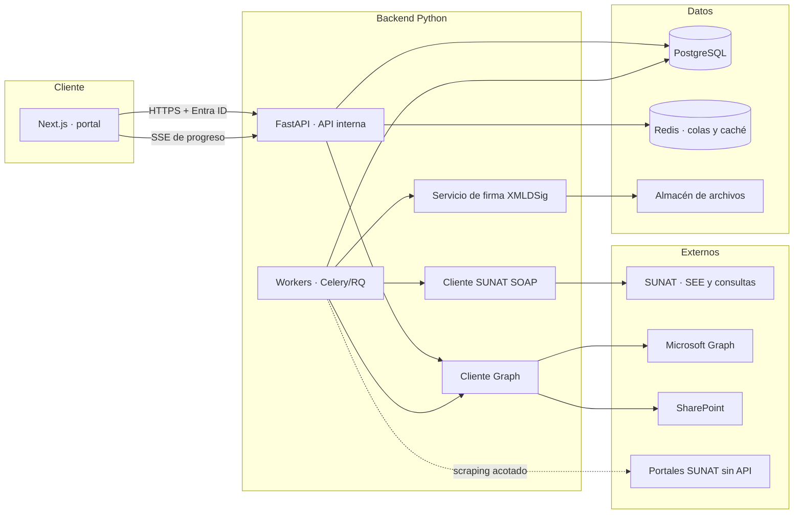
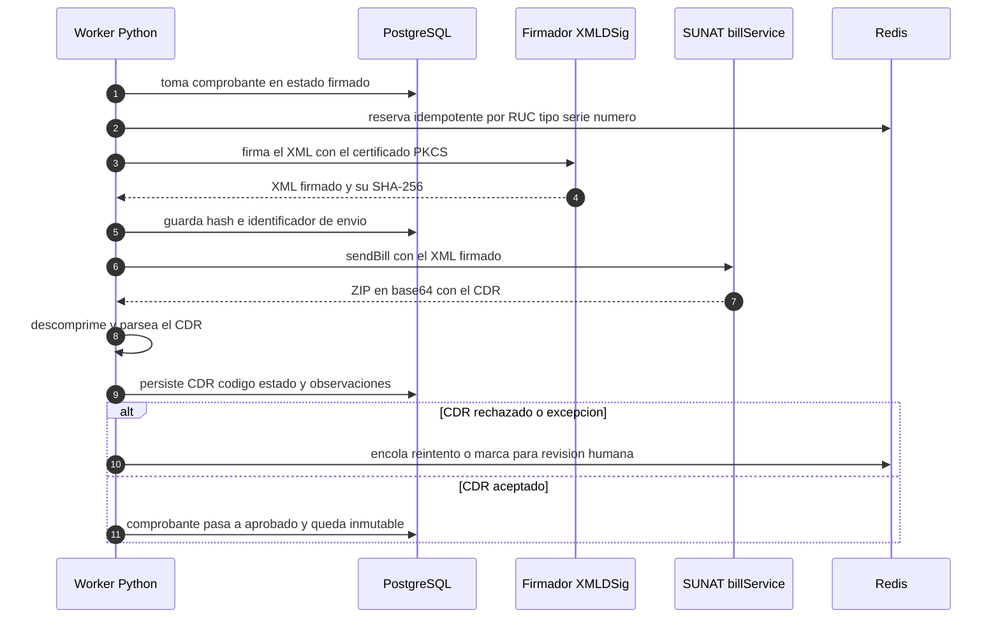
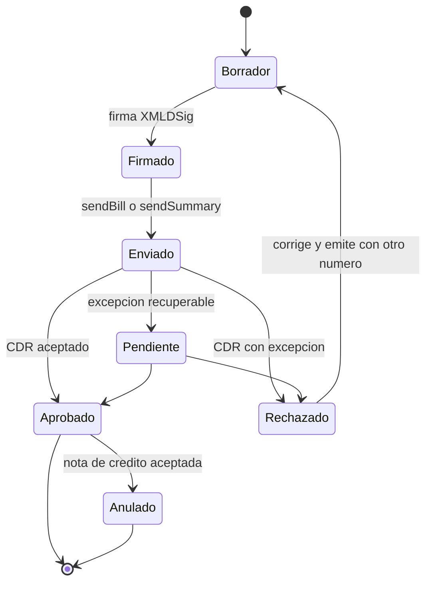

# Prompt maestro · Roadmap de mejoras — Portal de Facturación Electrónica TDM

> Documento de trabajo. **Nada de lo que aparece aquí está implementado**: es el mapa
> de mejoras futuras y el prompt que se debe pegar al inicio de cada iteración.
>
> Complementa a [`ARQUITECTURA.md`](./ARQUITECTURA.md), que describe **lo que ya existe**.

**Stack objetivo declarado:** API oficial de SUNAT · Python · Microsoft Graph API ·
SharePoint · scraping (solo como último recurso).

---

## 1. Cómo usar este documento

| Parte | Para qué sirve |
| --- | --- |
| §2–§3 | Contexto de partida y reglas que **no** se negocian. |
| §4–§5 | Stack y arquitectura objetivo. |
| §6 | **Roadmap por fases** con entregables y criterios de aceptación. |
| §7–§9 | Detalle de las tres integraciones críticas: SUNAT, Graph/SharePoint, scraping. |
| §10–§13 | Datos, seguridad, observabilidad y pruebas. |
| §14 | Mejoras de producto priorizadas (valor/esfuerzo). |
| §15 | *Definition of Done* transversal. |
| **§16** | **El prompt maestro listo para pegar.** |
| §17–§18 | Fuentes oficiales a validar y servicios de infraestructura. |

Regla de lectura: cada afirmación técnica sobre SUNAT está marcada con **⚠️ Validar**
cuando debe confirmarse contra la documentación oficial vigente antes de escribir código.

---

## 2. Estado actual (punto de partida)

Hoy es un **prototipo front-end** de una sola página:

- **Sí es real:** exportación a PDF, XML UBL 2.1, Excel y ZIP (todo en el navegador) y el
  envío de correo con Resend desde un Route Handler.
- **Es simulado:** los datos (`lib/mock-data.ts`), la "consulta a SUNAT" (un `setTimeout`)
  y el estado de los comprobantes. El XML **no está firmado**.

### Lo que no existe y hay que construir

| Brecha | Impacto |
| --- | --- |
| Persistencia (no hay base de datos) | Nada sobrevive a un recargar la página. |
| Autenticación y autorización | El portal es público y la ruta de correo también. |
| Firma digital y envío real a SUNAT | Es la razón de ser del sistema. |
| Colas y trabajos en segundo plano | Reintentos, resúmenes y conciliaciones no caben en una petición HTTP. |
| Archivo documental (SharePoint) | Sin repositorio auditable de XML, PDF y CDR. |
| Multi-empresa real y auditoría | No hay trazabilidad de quién hizo qué. |
| Observabilidad | Cero visibilidad de fallos en producción. |

---

## 3. Reglas invariables (no negociables)

1. **No romper lo existente.** PDF/XML/Excel/ZIP, filtros, búsqueda, selección masiva y
   toasts deben seguir funcionando después de cada iteración.
2. **Solo canales oficiales primero.** El scraping es el **último** recurso, nunca el
   primero (§9).
3. **Secretos fuera del código.** Credenciales SOL, claves de API y el certificado
   digital **jamás** en el repositorio, en el frontend ni en un `.env` de producción.
4. **Idempotencia fiscal.** Un comprobante se envía **una sola vez**. Guardar el hash del
   XML enviado y el identificador de envío.
5. **Inmutabilidad tributaria.** Un comprobante aceptado por SUNAT no se edita: se anula
   con nota de crédito. La base de datos debe ser *append-only* para hechos fiscales.
6. **Datos fiscales = datos sensibles.** Minimizar, cifrar, registrar accesos y no
   volcar RUC/DNI ni XML completos en los logs.
7. **Todo cambio con pruebas.** Un cambio sin prueba y sin forma de verificarlo no está
   terminado (§15).
8. **Trazabilidad por correlación.** Cada operación fiscal debe poder rastrearse desde el
   clic del usuario hasta el CDR.

---

## 4. Stack objetivo y responsabilidades

| Componente | Tecnología | Responsabilidad |
| --- | --- | --- |
| Frontend | Next.js (ya existe) | UI, filtros, previsualización, acciones. |
| Backend de negocio | **Python + FastAPI** | Reglas fiscales, orquestación, API interna. |
| Modelo de dominio | `pydantic` v2 | Validación estricta de comprobantes y emisores. |
| Firma XML | `lxml` + `signxml` + `cryptography` | XMLDSig enveloped con certificado PKCS#12. |
| Cliente SOAP SUNAT | `zeep` **o** `httpx` con sobre SOAP propio | `sendBill`, `sendSummary`, `getStatus`, `getStatusCdr`. |
| Trabajos en segundo plano | `Celery` / `arq` / `RQ` + **Redis** | Envíos, reintentos, resúmenes, conciliaciones. |
| Base de datos | **PostgreSQL** + SQLAlchemy + Alembic | Persistencia fiscal, auditoría, idempotencia. |
| Correo + archivos | **Microsoft Graph** + **SharePoint** | Envío corporativo y archivo documental. |
| Observabilidad | Sentry / Highlight.io | Errores, trazas, alertas. |
| Extracción sin API | **Playwright** | Último recurso (§9). |
| Empaquetado | Docker + `uv` | Reproducibilidad entre entornos. |

> `zeep` es más rápido de arrancar; un sobre SOAP propio con `httpx` da control total
> sobre el `UsernameToken`, los timeouts y los reintentos. Decidir en la F3 con una
> prueba de concepto contra homologación.

---

## 5. Arquitectura objetivo



Notas de diseño:

- **El navegador deja de firmar y de enviar.** La firma y el envío a SUNAT ocurren en el
  backend: el certificado nunca sale del servidor.
- **Redis** cumple dos papeles: cola de trabajos y caché de idempotencia.
- **Almacén de archivos**: primero SharePoint (lo que el negocio ya usa) y, si el volumen
  o el rendimiento lo exige, un object storage como caché de trabajo.
- **El progreso de lotes** se comunica al portal con SSE o WebSocket, no con polling ciego.

---

## 6. Roadmap por fases

### F0 · Endurecer el prototipo (sin backend)

**Objetivo:** dejar la base actual sólida antes de añadir superficie.

- Pruebas unitarias de `lib/format.ts` (IGV, redondeo, periodos) y de los generadores.
- Pruebas con *golden files*: un XML, un XLSX y un ZIP de referencia por tipo de documento.
- CI en GitHub Actions: `pnpm install --frozen-lockfile`, `pnpm lint`, `pnpm build`, tests.
- Manejo explícito de fechas y zona horaria (`America/Lima`) en el dominio.
- Mensajes de error de la UI unificados (hoy cada componente arma el suyo).

**Aceptación:** CI verde en un PR, y cambiar una regla de negocio rompe al menos un test.

### F1 · Base del backend Python

**Objetivo:** esqueleto productivo con autenticación y persistencia.

- FastAPI + estructura por dominios (`emisores`, `comprobantes`, `envios`, `archivos`).
- PostgreSQL con Alembic; migraciones versionadas.
- Autenticación con **Entra ID** (login del portal → token → API).
- RBAC: un usuario solo ve las empresas que le corresponden.
- Endpoints internos que replican en servidor lo que hoy hace el navegador
  (filtrado, métricas) para que el frontend deje de tener la verdad del negocio.

**Aceptación:** `/health` y `/ready` responden; un usuario sin permiso sobre Tecnología de Materiales
recibe `403` en la API **y** la UI no le muestra la empresa.

### F2 · Firma digital y XML real

**Objetivo:** que el XML sea válido ante SUNAT, no una simulación.

- Custodia del certificado PKCS#12 (`.pfx`) y su contraseña en el gestor de secretos.
- Firma **XMLDSig enveloped** con `signxml`; el bloque `ext:UBLExtensions` deja de estar
  vacío.
- Validación contra los **XSD oficiales** de UBL 2.1 y las reglas de SUNAT.
- Reemplazar los catálogos resumidos actuales por tablas completas y verificables.
- Casos de negocio hoy ausentes: exonerado, inafecto, gratuito, descuentos, anticipos,
  detracción, múltiples formas de pago, moneda distinta de PEN.

**Aceptación:** un juego de comprobantes de homologación se firma, valida contra XSD y la
verificación de autenticidad de SUNAT los acepta.

> **⚠️ Validar** los requisitos de firma, los catálogos y el algoritmo exigido en el
> *Manual del programador* vigente (§17).

### F3 · Integración SUNAT (SEE-Del contribuyente)

**Objetivo:** emitir de verdad, con CDR almacenado.

- Cliente SOAP de `billService`: **`sendBill`** (comprobantes individuales) y
  **`sendSummary`** (resúmenes diarios de boletas y comunicaciones de baja).
- Consulta de estado y recuperación del CDR en el servicio de consultas
  (**`getStatusCdr`**), que vive en otro *endpoint* y puede exigir credenciales
  distintas (usuario secundario / claves de cliente). **⚠️ Validar.**
- Parseo del **CDR** (viene en un ZIP codificado en base64): extraer código, estado y
  observaciones y persistirlos.
- **Idempotencia**: clave = RUC emisor + tipo + serie + número; guardar el SHA-256 del
  XML firmado y el identificador de envío.
- **Reintentos** con *backoff* exponencial y cola de descartes (DLQ) para lo irrecuperable.
- Dos entornos separados desde el día uno: **homologación/beta** y **producción**, con
  credenciales y hosts distintos. **⚠️ Validar** la lista vigente de *endpoints*.
- Recordatorios normativos: las **facturas** van individuales; las **boletas** se envían en
  **resumen diario** dentro de plazo; **guías de remisión**, **retenciones** y
  **percepciones** tienen su propio circuito.

**Aceptación:** un comprobante enviado a homologación queda `Aprobado`, su CDR está en la
base, y reenviarlo devuelve el mismo resultado **sin** duplicar el envío.

**Riesgos:** vencimiento de credenciales SOL, cambios de *endpoint*, mantenimientos de
SUNAT, y códigos de excepción que exigen corrección manual. Mitigación: alertas, cola
visible y reintento con intervención humana.

### F4 · SharePoint y Microsoft Graph

**Objetivo:** archivo documental auditable y correo corporativo.

- Archivar **XML, PDF y CDR** en SharePoint con esta jerarquía:
  `/{empresa}/{año}/{mes}/{tipo-documento}/`.
- Metadatos como columnas del *driveItem*: RUC, serie, número, estado, fecha, hash.
- Correo por **Graph `sendMail`** en sustitución de Resend si el correo del grupo es
  Microsoft 365: elimina un proveedor externo y deja traza en el *tenant*.
- Sincronización de estados: si SUNAT rechaza, actualizar el metadato en SharePoint.

**Aceptación:** cada comprobante enviado tiene sus tres archivos en SharePoint, con
metadatos correctos y enlace verificable desde el portal.

> Detalle de permisos, límites de subida y *throttling* en §8.

### F5 · Extracción y conciliación

**Objetivo:** completar el ciclo tributario más allá de la emisión.

- **Consulta Integrada de Comprobante de Pago por ServicioWeb** para validar comprobantes
  emitidos y recibidos (existe versión 2.0 del manual y credenciales de API propias).
- **SIRE** (Registro de Ventas e Ingresos / Registro de Compras) para conciliar.
- **Padrones de RUC** publicados por SUNAT para validar razón social y estado sin scraping.
- **Scraping acotado** solo donde no exista API (§9).
- Motor de conciliación: diferencias entre lo emitido, lo reportado y lo cobrado.

**Aceptación:** el portal muestra, por periodo, la diferencia entre ventas emitidas y
ventas reportadas, con su motivo.

### F6 · Producto y operación

**Objetivo:** que el portal sea usable como herramienta diaria, no como demo.

- Emisión desde el portal (borrador → firmar → enviar) y notas de crédito/débito enlazadas.
- Resumen diario de boletas automatizado.
- Descarga masiva por rango con progreso real y reanudación.
- Bandeja de "comprobantes recibidos" con validación automática.
- Alertas: certificado por vencer, comprobantes pendientes, cola estancada.
- Paneles por empresa y exportes contables.
- **SLOs** definidos (por ejemplo, disponibilidad del portal y tiempo máximo hasta CDR).

---

## 7. Integración SUNAT en detalle

### 7.1 Superficies disponibles

| Necesidad | Canal | Naturaleza |
| --- | --- | --- |
| Enviar facturas / notas / guías | `billService` → `sendBill`, `sendSummary` | **SOAP** con firma |
| Consultar estado de un envío | `getStatus` / `getStatusCdr` | **SOAP** (otro servicio) |
| Validar un CPE (emitido o recibido) | Consulta Integrada de Comprobante de Pago por ServicioWeb | **Servicio web** con credenciales de API propias |
| Autenticidad de un archivo digital | Verificación de autenticidad de archivo digital | Portal |
| Datos de contribuyentes | Padrones de RUC publicados | **Descarga de archivos** |
| Declaraciones de ventas/compras | SIRE | Servicio |

Regla práctica: **si existe servicio, no se automatiza el portal** (§9).

### 7.2 Ciclo de vida de un envío



### 7.3 Reglas que evitan incidentes fiscales

- **Nunca** reenviar un comprobante con CDR aceptado: SUNAT lo rechazará por duplicado.
- Un rechazo por **datos** exige corregir y emitir de nuevo con otro número; un rechazo por
  **infraestructura** se reintenta.
- Guardar el **XML firmado** y el **CDR** juntos: son la prueba ante una fiscalización.
- Separar estrictamente credenciales y *hosts* de **homologación** y **producción**
  (variables distintas, nunca una bandera booleana compartida).
- **Custodiar el certificado**: vencimiento, contraseña y rotación.

> **⚠️ Validar** en el *Manual del programador* y en la guía de servicios web (§17):
> *endpoints* vigentes, métodos exactos, formato del `UsernameToken`, parámetros de
> `getStatusCdr`, plazos de resumen diario y códigos de error.

---

## 8. Microsoft Graph + SharePoint

### 8.1 Autenticación

- Registro de aplicación en **Entra ID**; flujo *client credentials* para procesos
  desatendidos (workers) y flujo delegado para acciones del usuario.
- Preferir **certificado** en lugar de secreto de cliente para la app desatendida.
- Permisos de aplicación: **`Sites.Selected`** (acotar el sitio, no todo el *tenant*) y
  **`Mail.Send`**.
- `Mail.Send` de aplicación requiere además una **Application Access Policy** en Exchange
  Online que restrinja los buzones autorizados; sin ella, Graph responde `403`.

### 8.2 SharePoint como archivo documental

- Localizar el sitio y su *drive* una sola vez y cachear el identificador.
- Subida simple con `PUT` al contenido del *driveItem*; para archivos grandes, sesión de
  subida en fragmentos.
- Estructura de carpetas por empresa/año/mes/tipo, con metadatos como columnas para poder
  consultar por RUC, serie/numero o estado.
- Activar **versionado** y **retención**: los comprobantes no se borran.

### 8.3 Operación responsable

- Respetar `429` y esperar el `Retry-After` indicado; usar peticiones por lote para
  agrupar operaciones pequeñas.
- Reintentos con *backoff*; no reintentar errores `4xx` de permisos.
- Idempotente por diseño: antes de subir, comprobar si el archivo ya existe y comparar
  hash.

---

## 9. Scraping: cuándo sí y cuándo no

### Regla

```
¿Existe servicio web o padrón descargable? ──sí──► úsalo (nunca scraping)
                     │
                     no
                     ▼
¿Es imprescindible para el negocio? ──no──► no lo hagas
                     │
                    sí
                     ▼
Scraping acotado, registrado y aprobado (§9.2)
```

### 9.1 Cuándo es legítimo

- **Consulta RUC**: el portal público exige un **captcha**, de modo que la automatización
  completa no es viable ni adecuada. Alternativa preferida: **padrones de RUC** publicados
  por SUNAT.
- Reportes del **Menú SOL** que no tengan servicio asociado. Nota: el Menú SOL ya usa
  **OAuth2**, lo que puede permitir una integración más ordenada que el *scraping* clásico.
- Complementos de conciliación mientras madura una API oficial.

### 9.2 Guardrails obligatorios

**Técnicos**

- **Playwright** en modo visible durante el desarrollo; tiempos humanos entre acciones.
- **Human-in-the-loop** para captchas: nunca resolverlos automáticamente ni eludir
  mecanismos de protección.
- Caché agresiva y *rate limiting* propio; nunca paralelizar contra un portal público.
- Sesión persistente y rotación controlada; reintentos con *backoff*.
- Selectores versionados con pruebas que detecten cambios de maquetación.

**Organizativos y legales**

- Revisar los **términos de uso** de cada portal y obtener aprobación formal del área.
- Credenciales SOL en el gestor de secretos, con usuario **dedicado** y permisos mínimos.
- Registrar cada extracción (qué, cuándo, quién, para qué) igual que un envío fiscal.
- Si SUNAT publica una API equivalente, **migrar y retirar** el *scraper*.

---

## 10. Datos, estados y auditoría

### 10.1 Tablas propuestas

| Tabla | Contenido |
| --- | --- |
| `empresas` | RUC, razón social, domicilio, credenciales asociadas (referencia al secreto). |
| `clientes` | RUC/DNI, razón social, correo. |
| `comprobantes` | Cabecera fiscal: tipo, serie, número, fechas, montos, estado. |
| `comprobante_items` | Detalle de líneas. |
| `firmas` | Hash del XML, certificado usado, fecha de firma. |
| `envios_sunat` | Petición, respuesta cruda, estado, intentos, `correlacion_id`. |
| `cdr` | Código, estado, observaciones y el archivo original. |
| `archivos` | Referencia a SharePoint u otro almacén, con hash y tipo. |
| `usuarios` / `roles` | Identidad de Entra ID y permisos por empresa. |
| `auditoria` | *Append-only*: quién hizo qué y cuándo. |

### 10.2 Máquina de estados del comprobante



Reglas transversales: *timestamps* en UTC con conversión en la UI, índice único sobre
(ruc emisor, tipo, serie, número), y **append-only** para todo lo que es hecho fiscal.

---

## 11. Seguridad y cumplimiento

- **Gestor de secretos** para credenciales SOL, claves de API y el certificado. Rotación
  programada y alerta 30 días antes del vencimiento del certificado.
- **RBAC por empresa**; principio de mínimo privilegio también para la app de Entra ID.
- **Logs sin datos sensibles**: no volcar XML completos, RUC o DNI sin enmascarar.
- **Cifrado** en tránsito y en reposo; respaldos con prueba de restauración documentada.
- **Revisión previa** del tratamiento de datos personales (los comprobantes contienen
  datos de terceros).

---

## 12. Observabilidad y operación

| Señal | Qué medir | Alerta |
| --- | --- | --- |
| Envíos | Tasa de aprobación por día y por empresa | Caída de más del 20 % respecto a la media. |
| Latencia | Tiempo de `sendBill` y hasta CDR | Percentil 95 por encima del umbral acordado. |
| Cola | Profundidad y edad del trabajo más viejo | Cola creciendo o trabajo de más de 30 min. |
| Reintentos | Tasa de reintento y descartes en DLQ | Un solo descarte ya es alerta. |
| Correo | Entregas y rebotes vía Graph | Rebotes por encima del umbral. |
| Infraestructura | Certificado, secretos y permisos | Vencimiento próximo o `403` de Graph. |

Toda traza debe compartir un `correlacion_id` desde el clic del usuario hasta el CDR.

---

## 13. Pruebas y calidad

1. **Unitarias de dominio**: IGV, redondeo, notas de crédito, límites y casos borde.
2. **Golden files**: XML de referencia por tipo de documento, comparados de forma
   normalizada (sin espacios ni órdenes accidentales).
3. **Validación de esquemas**: cada XML generado se valida contra los XSD.
4. **Contract tests** contra **homologación** (nunca producción) con un juego fijo de
   comprobantes, incluido un duplicado a propósito.
5. **E2E del portal**: Playwright sobre el flujo completo (seleccionar empresa → filtrar →
   detalle → descargar).
6. **Pruebas de caos controlado**: SUNAT no responde, Graph devuelve `429`, Redis cae.

---

## 14. Mejoras de producto priorizadas

Alto valor, esfuerzo contenido:

1. **Emisión desde el portal** (borrador → firmar → enviar) con validación previa.
2. **Notas de crédito y débito** enlazadas al comprobante de referencia.
3. **Resumen diario de boletas** automático, con control de plazos.
4. **Descarga masiva con progreso real** (SSE) y reanudación de lotes interrumpidos.
5. **Bandeja de comprobantes recibidos** con validación automática de validez.
6. **Conciliación con SIRE** por periodo, con informe de diferencias.
7. **Validación de RUC contra padrón** antes de emitir, para evitar rechazos.
8. **Detección de duplicados** previa al envío.
9. **Multi-empresa y multi-usuario** con RBAC y paneles por empresa.
10. **Alertas operativas** (certificado, pendientes, cola) en el propio portal.
11. **Exportes contables** (formato de libro de ventas) además del Excel actual.
12. **Búsqueda avanzada** por rango de montos, forma de pago y estado.
13. **Modo PWA** para consulta offline de lo ya cargado.
14. **Bitácora visible** de cada comprobante (firmado, enviado, CDR, correo, archivo).

---

## 15. Definition of Done (transversal)

- [ ] Las funciones existentes siguen funcionando (PDF/XML/Excel/ZIP, filtros, selección, toasts).
- [ ] Pruebas nuevas para la lógica añadida; `lint`, `build` y tests en verde.
- [ ] Sin secretos, credenciales ni datos fiscales reales en el repositorio.
- [ ] Idempotencia verificada en la operación fiscal afectada.
- [ ] Documentación actualizada (`ARQUITECTURA.md` y/o este archivo).
- [ ] Trazabilidad: `correlacion_id` propagado y evento de auditoría registrado.
- [ ] Comportamiento definido para el fallo (reintento, DLQ o mensaje al usuario).
- [ ] Verificado contra **homologación** antes de plantear producción.

---

## 16. Prompt maestro (bloque listo para pegar)

```text
Actúa como Arquitecto de Software Senior y Desarrollador Python/Next.js, especializado
en facturación electrónica peruana (SUNAT), integración con Microsoft Graph y SharePoint.

CONTEXTO
- Proyecto: Portal de Facturación Electrónica del Grupo TDM (Next.js 16 + React 19 +
  Tailwind v4 + GSAP). Hoy es un prototipo front-end con datos simulados.
- Lee primero ./ARQUITECTURA.md (lo que existe) y ./PROMPT-MAESTRO-MEJORAS.md (el plan).
- Stack objetivo: API oficial de SUNAT, Python (FastAPI), Microsoft Graph API,
  SharePoint y scraping como último recurso.

FASE A IMPLEMENTAR
{{FASE}}  (por ejemplo: F3 · Integración SUNAT con sendBill y CDR)

ALCANCE
{{ALCANCE}}  (qué entra y qué queda fuera)

REGLAS INVARIABLES
1. No romper ninguna función existente: PDF/XML/Excel/ZIP, filtros, búsqueda, selección
   masiva, toasts y estado actual del portal.
2. Solo canales oficiales de SUNAT primero. El scraping es último recurso y requiere
   guardrails explícitos (rate limiting, human-in-the-loop para captchas, registro).
3. Secretos (credenciales SOL, claves de API, certificado .pfx) NUNCA en el repositorio,
   en el frontend ni en .env de producción: van al gestor de secretos.
4. Idempotencia fiscal: un comprobante se envía una sola vez; guarda el hash del XML
   firmado y el identificador de envío.
5. Un comprobante aceptado por SUNAT es inmutable: se anula con nota de crédito.
6. Homologación y producción con credenciales y hosts separados, nunca una bandera.
7. Todo cambio acompañado de pruebas y de comportamiento definido ante fallo
   (reintento, DLQ o mensaje al usuario).
8. Datos fiscales = datos sensibles: no volcar XML, RUC ni DNI en logs.

MÉTODO DE TRABAJO
- Antes de escribir código: explora el repositorio, confirma los supuestos y lista los
  archivos que vas a tocar. Si algo de SUNAT no está confirmado, dilo y consúltalo en la
  documentación oficial; no inventes endpoints, códigos de error ni catálogos.
- Diseña primero los modelos y los estados; después la integración; al final la UI.
- Implementa en cambios pequeños y verificables.
- Verifica ejecutando: lint, typecheck/build y las pruebas que apliquen. Reporta el
  resultado real, incluidos los fallos.

ENTREGABLES
- Código y migraciones.
- Pruebas (unitarias, golden files o contract tests según la fase).
- Actualización de ARQUITECTURA.md / PROMPT-MAESTRO-MEJORAS.md.
- Resumen final: qué se hizo, cómo se verificó, qué quedó pendiente y qué riesgos
  detectaste.

CRITERIO DE ACEPTACIÓN
{{CRITERIOS}}
```

---

## 17. Fuentes oficiales a validar antes de implementar

> Los *endpoints*, versiones y plazos cambian. **Valida siempre** en la documentación
> vigente; no copies valores de este documento sin comprobarlos.

| Tema | Fuente |
| --- | --- |
| Manual del programador (envíos y servicios) | `https://cpe.sunat.gob.pe/sites/default/files/inline-files/manual_programador%20%281%29.pdf` |
| Consulta Integrada de Comprobante de Pago por ServicioWeb (v2.0) | `https://cpe.sunat.gob.pe/sites/default/files/inline-files/Manual-de-Consulta-Integrada-de-Comprobante-de-Pago-por-ServicioWEB_v2_0.pdf` |
| Servicios web disponibles (orientación) | `https://orientacion.sunat.gob.pe/guias-manuales-y-servicios-web` |
| SEE del contribuyente | `https://www.gob.pe/25681-sistema-de-emision-electronica-del-contribuyente` |
| Consulta integrada de validez de comprobantes | `https://www.sunat.gob.pe/accesosDirectos/validaComprobante-p.html` |
| Verificación de autenticidad del archivo digital | `https://ww1.sunat.gob.pe/ol-ti-itconsverixml/ConsVeriXml.htm` |
| Menú SOL (autenticación OAuth2) | `https://api-seguridad.sunat.gob.pe/oauth2/login` |
| Consulta RUC (tiene captcha) | `https://e-consultaruc.sunat.gob.pe/cl-ti-itmrconsruc/jcrS00Alias` |
| Microsoft Graph | `https://learn.microsoft.com/graph/` |
| SharePoint con Graph (drives y subidas) | `https://learn.microsoft.com/graph/api/driveitem-put-content` |
| Restringir buzones de `Mail.Send` de aplicación | `https://learn.microsoft.com/graph/auth-limit-mailbox-access` |

---

## 18. Servicios de infraestructura (catálogo validado)

Opciones consultadas en el catálogo de servicios (no recomendaciones de memoria):

| Necesidad | Opción | Por qué | Alternativa |
| --- | --- | --- | --- |
| Base de datos | **Neon** (Postgres *serverless* con *branching*) | Permite una base por *preview* y escalado gestionado; encaja con FastAPI + SQLAlchemy. Docs: `https://neon.tech/docs` | Cualquier Postgres gestionado de su nube, si la organización lo exige. |
| Colas y caché | **Redis Cloud** | Servicio gestionado compatible con Celery/RQ/arq y con caché de idempotencia. Docs: `https://redis.io/docs` | **Upstash** si los *workers* viven en entorno *serverless* (API HTTP y precio por uso). |
| Observabilidad | **Sentry** o **Highlight.io** | Errores y trazas en FastAPI y en *workers*; Highlight es *open source* y autoalojable. | Logs estructurados + alertas de la nube como mínimo viable. |
| Gestor de secretos | *No hay opción en el catálogo* | El catálogo no ofrece gestión de secretos con auditoría y rotación. | Usar el **vault nativo de su nube** (por ejemplo, Azure Key Vault, coherente con Entra ID y SharePoint) para credenciales SOL y el certificado. |

---

## 19. Siguiente paso sugerido

Empezar por **F0** y **F1** en paralelo:

1. F0 no depende de nadie y protege todo lo que ya funciona.
2. F1 define la base sobre la que se montan F2–F4; conviene decidir ya la base de datos y
   el gestor de secretos, porque condicionan el resto.

No iniciar **F3** (envíos reales) sin haber cerrado **F2** (firma válida) y sin
homologación a mano: enviar a producción con un XML mal formado genera rechazos que
consumen numeración fiscal.
